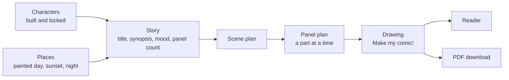

<p align="center">
  
</p>

# Comickadha

**Kids under 16 design their own characters and places, write a story, and get a comic.**

Comickadha is a web app where a child builds a cast of characters, paints the places their story happens in, writes the story in their own words, and watches it turn into comic panels they can edit, read and download as a PDF. It runs completely offline with built-in mock helpers, and can switch to Meta's model API and Muse Image for smarter help and painted art, with every word and picture checked for kids first.

## What kids can do

**Character Lab**
- Build characters Bitmoji-style from a parts library: 6 body types (kid, grown-up, robot, cat, dog, bear), faces, eyes, hair, hats and head coverings, outfits, extras and colours, with undo and drag-and-drop.
- Get help from the Buddy helper: describe a character in words, "Surprise me", name and personality ideas, or start from a photo of their own drawing (only after a grown-up says OK; the drawing is never stored).
- Or use the guided **Create character** flow, which designs a character from a few choices and a description.
- **Lock** a character so they look the same in every panel: their sheet has 16 poses and 6 faces, and panels can also show them asleep. Locking again keeps the old version for comics that already use it.
- Get a **painted portrait** of each locked character (an inked-and-painted illustration made from their design), or keep showing their drawing.
- Keep up to **40 characters** of their own.

**Starter characters**
- 12 ready-made characters for any story. They don't use any of the kid's slots, and "Make it mine" copies one into the kid's own cast to change it.

**Places**
- Describe a place and paint it. Each place gets a day picture plus **sunset and night** versions, so a scene shows the same place in that light. "Paint it again" makes a new version without changing comics that already use the old one.

**Story Studio**
1. **Story:** a title, a synopsis (up to 1,000 letters), up to **5 characters** per comic, one of **18 story moods** (Mystery, Funny, Adventure, Spooky-ish, Magical, Fairy Tale, Folk Tale, Underwater, Dinosaur, Jungle Safari, Pirate, Space, Robots and Future, Time Travel, Sporty, School Days, Festival, Nature Hero) and **any number of panels from 4 to 200**.
2. **Scenes and places:** the planner splits the story into scenes (the kid can have up to 12), each with its place, time of day, cast, key moment and its own number of panels.
3. **Panels:** the planner writes every panel (who is in it, poses, faces, props, speech and thought bubbles, captions, panel sizes) and the kid can change any of it.
- A **Story Buddy** asks questions to help them think, checks spelling and suggests scene titles. It never writes the story for them.

**Make my comic! and the Reader**
- "Make my comic!" draws every panel: the place at the right time of day, the characters facing each other, props, and bubbles pointing at whoever speaks (12 words per bubble at most).
- The Reader shows the comic page by page; in Edit mode kids drag bubbles, change words, faces, poses and who stands where.
- **Download a PDF** with a cover and the panels, sized to print on A4 or Letter.

## How it works



- **Characters** are drawn from the shared SVG parts library. The same drawing code exists in Python (API) and TypeScript (web) and is kept identical by golden-file tests.
- **The planner** turns the story into scenes, then writes the panels a few parts at a time, checks every panel against the rules (only the scene's characters, a sleeping character never speaks, every prop a bubble names is drawn, bubbles of 12 words at most), asks again for panels that break a rule and repairs the rest.
- **Drawing** happens on the server: each panel is composed from the pinned character versions, the pinned place version, props and lettered bubbles. Old comics never change when a character or place changes later.
- **Helpers** run offline by default. With Meta switched on, the Lab helper, Story Buddy, planner and safety classifier use Meta's model API, and places and portraits are painted by Muse Image.

## Safety for kids

The app treats every child's words and every generated picture as something to check first:

- **Local checks on kid-written text** (always on): personal details stay secret (phone numbers, email addresses, home addresses and school names), plus a word list. Character names are also checked against famous and real people.
- **The safety classifier** (with Meta on): every kid-written word that goes into a Meta prompt (descriptions, names, catchphrases, story text, scene summaries, place names) is checked before the prompt is sent. If the classifier is down, the words stay offline only; story text saved then is marked "not yet checked" and re-checked automatically, and the PDF waits until it passes.
- **Every picture Muse Image paints is checked** by a vision model before it is saved or shown (places and portraits; mock pictures are drawn on the machine). Painted portraits also pass a **look check** that compares the painting with the character's design, so a painting can't change a child's skin tone, drop a head covering or add someone else.
- **What image prompts carry:** a portrait prompt has no kid-written words at all (the look is described in the parts library's own words and colour values); a place prompt carries the place's name and description only after they pass the checks.
- **Story rules** for the planner and helpers: kind and playful, no violence, nothing too scary, no real people's names and no personal details.
- **Drawings** are sent only after a grown-up's OK and are never stored.
- **Kid-friendly errors:** every error has a message written for a child and is shown next to the field it is about.
- **Privacy in logs:** the kid's words are never logged; usage logs carry call names and token counts only.
- **Painting limits:** a switch turns all painting off, and daily caps limit how many pictures a kid (and everyone together) can paint.

## Tech stack

| Part | What it uses |
| --- | --- |
| API | Python 3.11, FastAPI, SQLModel on SQLite, Pydantic settings, Pillow, resvg (SVG to PNG), the OpenAI-compatible client for Meta's API; managed with uv |
| Web | React 19, Vite 6, TypeScript 5.9, Tailwind CSS 4, React Router 7, Zustand 5, dnd-kit |
| Shared | The avatar parts catalog and golden files used by both the API and the web app |
| Checks | pytest, Ruff, mypy; ESLint, Vitest, `tsc` |

## Project structure

```text
comickadha/
├── api/                  FastAPI service
│   ├── app/
│   │   ├── routers/      HTTP endpoints (characters, builder, places, comics, studio, jobs, media)
│   │   ├── services/     planner, safety checks, painting, compositor, lettering, PDF, jobs
│   │   ├── providers/    Meta text/vision, Muse Image, and the offline mock
│   │   ├── avatar/       parts catalog, rig, compose and render (Python twin)
│   │   ├── props/        the props library
│   │   ├── prompts/      every prompt the app sends, one file each
│   │   ├── models/       database tables
│   │   └── schemas/      request and response shapes
│   ├── assets/fonts/     the lettering fonts
│   └── tests/            pytest suite
├── web/                  React app
│   └── src/              pages, components, stores, avatar (TypeScript twin), lib, types
├── shared/avatar/        parts catalog, generator and golden files
├── docs/                 architecture, decisions, character safety policy
├── scripts/              check_secrets.py
└── .githooks/            pre-commit secret check
```

## Quick start

You need [uv](https://docs.astral.sh/uv/) (it installs Python 3.11 for you) and Node.js 20.15 or newer. No API keys are needed: by default everything runs on the offline mock providers. On first start the API creates its database and adds demo data (one kid, three characters, three places, three comics and the twelve starter characters).

### Windows (PowerShell)

Run the commands one line at a time from the project folder.

```powershell
# Settings (optional for mock mode)
Copy-Item .env.example .env

# Terminal 1: the API on http://localhost:8010
cd api
uv sync
uv run uvicorn app.main:app --reload --port 8010

# Terminal 2: the web app on http://localhost:5173
cd web
npm install
npm run dev
```

### macOS and Linux

```bash
# Settings (optional for mock mode)
cp .env.example .env

# Terminal 1: the API on http://localhost:8010
cd api
uv sync
uv run uvicorn app.main:app --reload --port 8010

# Terminal 2: the web app on http://localhost:5173
cd web
npm install
npm run dev
```

Open http://localhost:5173. The web app passes `/api` and `/media` requests to the API, whose interactive docs are at http://localhost:8010/docs.

To reset to the demo data, run `uv run python -m app.seed` from `api/`.

### Mock mode and Meta mode

With `LLM_PROVIDER=mock` and `IMAGE_PROVIDER=mock` (the defaults), the offline helpers answer, places and portraits get placeholder art, and the safety checks are the local ones. To use Meta's model API and Muse Image, set `META_API_KEY`, `LLM_PROVIDER=meta`, `META_MODEL`, `IMAGE_PROVIDER=muse` and `META_IMAGE_MODEL` in `.env` and restart the API. `IMAGE_PROVIDER=muse` needs `LLM_PROVIDER=meta`, so every picture can be checked; the API refuses to start otherwise. Never commit `.env`.

### Configuration

Settings are read from the environment, then the project-root `.env`, then `api/.env`.

| Variable | What it does |
| --- | --- |
| `LLM_PROVIDER` | `mock` (offline helpers, local safety checks) or `meta` (Meta's model API for the helpers, planner and safety classifier) |
| `IMAGE_PROVIDER` | `mock` (placeholder art) or `muse` (places and portraits painted by Muse Image; needs `LLM_PROVIDER=meta`) |
| `META_API_KEY` | The key for Meta's model API |
| `META_MODEL` | The Meta text model |
| `META_VISION_MODEL` | The Meta vision model for picture checks; empty means `META_MODEL` |
| `META_BASE_URL` | The address of Meta's API |
| `META_TIMEOUT_SECONDS` | The default timeout for a Meta call |
| `META_IMAGE_MODEL` | The Muse Image model |
| `META_IMAGE_TIMEOUT_SECONDS` | The timeout for one painted picture |
| `PAINTING_ENABLED` | `false` turns off all painting (portraits and real-model places) |
| `PORTRAIT_PAINTS_PER_KID` | Daily cap on painted portraits per kid |
| `PANEL_PAINTS_PER_KID` | Daily cap on painted panels per kid |
| `PAINTS_PER_DAY` | Daily cap on painted pictures for everyone together |
| `RECHECK_SECONDS` | How often story text saved during a safety-classifier outage is checked again (0 turns it off) |
| `BUILDER_REVEAL_SECONDS` | Pause per character-sheet cell, so the sheet visibly fills in |
| `MOCK_DELAY_SECONDS` | Pause per mock picture, so progress is visible |
| `PANEL_REVEAL_SECONDS` | Pause after each panel of "Make my comic!" |
| `PLAN_REVEAL_SECONDS` | Pause after each part of an offline panel plan |
| `SEED_ON_STARTUP` | Add the demo data when the database is empty |
| `CORS_ORIGINS` | Web addresses allowed to call the API |
| `STORAGE_DIR` | Where the database and media files are kept (default `api/storage`) |
| `DATABASE_URL` | A database URL instead of the SQLite file in `STORAGE_DIR` |
| `API_PROXY_TARGET` | Used by the web dev server: where it sends `/api` and `/media` (default `http://localhost:8010`) |

## Tests and checks

```bash
# API (from api/)
uv run pytest
uv run ruff check .
uv run ruff format --check .
uv run mypy app tests
uv run ruff check ../shared
uv run ruff format --check ../shared

# Web (from web/)
npm run lint
npm test
npm run build
```

`npm run gen:types` (from `web/`) regenerates the web app's API types after an API schema change.

A pre-commit hook blocks commits that stage `.env` or anything shaped like an API key. Turn it on once per clone with `git config core.hooksPath .githooks`; `python scripts/check_secrets.py` scans every tracked file.

## Documentation

- [docs/architecture.md](docs/architecture.md): the architecture in detail, including what every Meta prompt carries and where it is checked
- [docs/decisions.md](docs/decisions.md): every design decision, numbered, in order
- [docs/character-safety.md](docs/character-safety.md): the character safety policy

## Credits

Bubble lettering, covers and PDFs use two fonts bundled in `api/assets/fonts/` (the web app loads the same fonts through `@fontsource`). Both are licensed under the [SIL Open Font License 1.1](https://openfontlicense.org); the licence texts sit next to the font files.

| Font | Used for | Licence |
| --- | --- | --- |
| [Bangers](https://github.com/googlefonts/bangers), © 2010 The Bangers Project Authors | Shout bubbles, titles, covers | [Bangers-OFL.txt](api/assets/fonts/Bangers-OFL.txt) |
| [Nunito](https://github.com/googlefonts/nunito), © 2014 The Nunito Project Authors | Talk, think and narrator bubbles, page numbers | [Nunito-OFL.txt](api/assets/fonts/Nunito-OFL.txt) |
